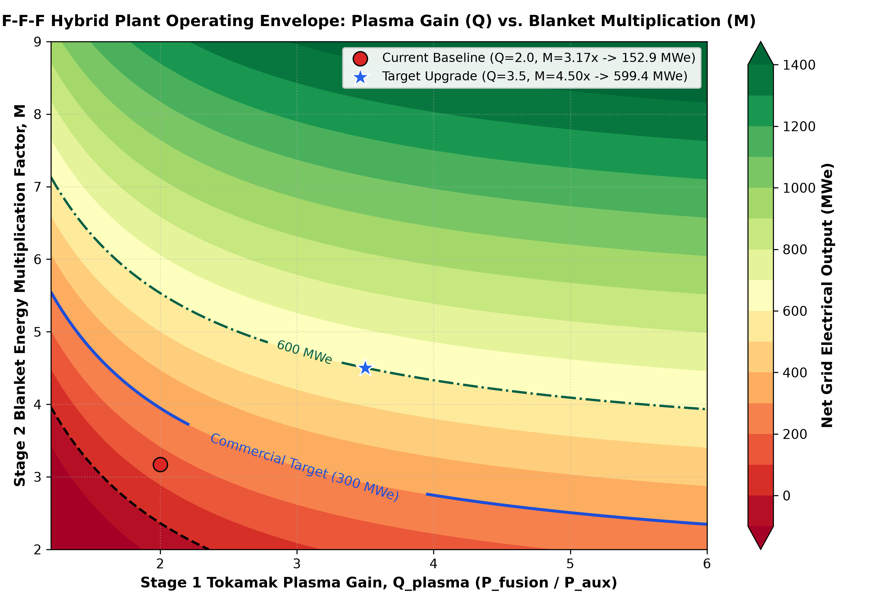

# End-to-End Fusion Neutronics & Thermal-Hydraulics Simulation Pipeline

An integrated simulation framework coupling **OpenMC** (Monte Carlo particle transport) and **OpenFOAM** (Computational Fluid Dynamics / Conjugate Heat Transfer) for advanced fusion reactor blanket and component analysis.

---

## 🚀 Pipeline Overview

This repository provides an automated workflow to translate high-fidelity CAD geometries into radiation transport models, compute volumetric nuclear heating (neutron and photon energy deposition), and map those heating distributions directly into CFD solvers to evaluate thermal stresses and cooling performance.
---

## 📂 Repository Structure

```text
├── cad/                  # CAD geometries and preprocessing scripts
├── openmc/               # OpenMC material definitions, tallies, and transport scripts
├── openfoam/             # OpenFOAM case setups, boundary conditions, and CHT solvers
├── scripts/              # Pipeline orchestration and data mapping automation
└── README.md             # Project documentation
Key Capabilities
Automated Data Coupling: Seamlessly maps Monte Carlo heating tallies from unstructured/structured OpenMC meshes onto OpenFOAM finite-volume grids.

Conjugate Heat Transfer (CHT): Evaluates solid-fluid thermal interactions under high-flux fusion neutron and heat loads.

Reproducible Workflow: Fully scripted Python and shell automation designed for high-performance computing (HPC) Linux environments.

🛠️ Prerequisites
OpenMC (with DAGMC and Python API support)

OpenFOAM (v10 or newer / OpenFOAM-v*)

Python 3.10+ (NumPy, SciPy, h5py)

📄 License
Distributed under the MIT License. See LICENSE for more information.

---

## ⚡ Power-Cycle Operating Envelope ($Q_{\text{plasma}}$ vs. Blanket Multiplication $M$)

Coupling the `631.62 °C` LBE outlet to a recompression **supercritical $\text{CO}_2$ ($\text{sCO}_2$) Brayton cycle** (`47.31%` gross thermal efficiency) yields **`152.92 MWe`** net grid output at the conservative $Q=2.0, M=3.17\times$ baseline, scaling past **`300+ MWe`** as $Q_{\text{plasma}}$ reaches $3.0–4.0$ or Stage 2 fertile uranium/TRU loading raises $M$ to $4.5\times$:


