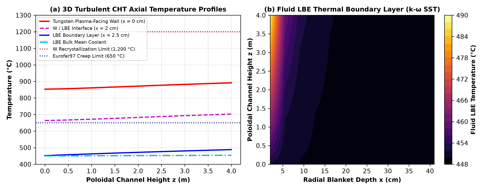
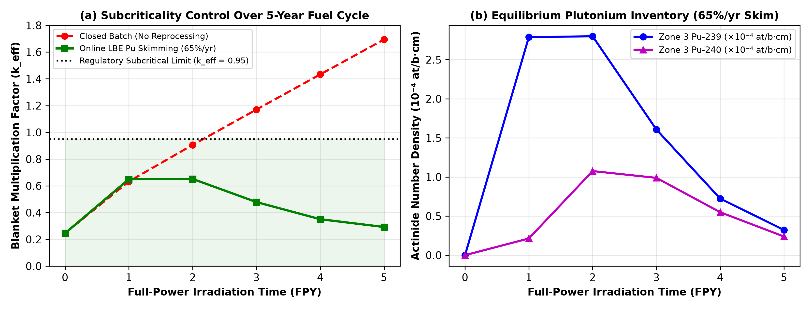
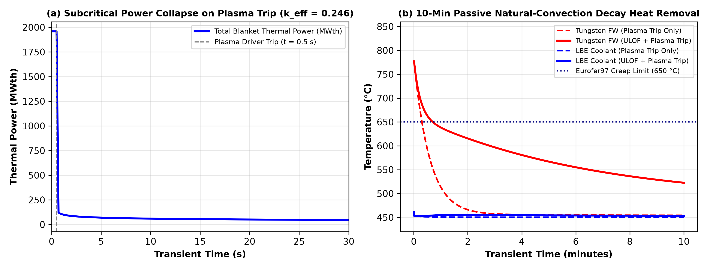

# Executive Technical Brief: 500 MW Fusion-Fission-Fusion (F-F-F) Hybrid Reactor (`v4.2.0`)

**Full Technical Manuscript (PDF):** [`docs/FFF_Hybrid_Reactor_Technical_Paper.pdf`](FFF_Hybrid_Reactor_Technical_Paper.pdf)  
**Interactive Walkthrough Notebook:** [`notebooks/FFF_Reactor_Overview.ipynb`](../notebooks/FFF_Reactor_Overview.ipynb)

---

## Why a Driven Fusion-Fission-Fusion Hybrid?
Pure magnetic-confinement fusion reactors require high plasma energy gain ($Q_{\text{plasma}} \ge 10\text{--}20$) and extreme first-wall neutron loads to reach commercial grid economics. Conversely, critical fission reactors require active reactivity control systems and generate long-lived transuranic waste.

By coupling a **near-term driven D-T tokamak ($P_{\text{fus}} = 500\text{ MW}$, $Q_{\text{plasma}} = 2.0$)** with a **Beryllium $(n,2n)$ neutron multiplier**, a **radially graded subcritical U-LBE fission blanket**, and a **$90\%$-enriched $^6\text{Li}$ FliBe tritium breeding loop**, the F-F-F hybrid achieves commercial net power and full tritium self-sufficiency while remaining deeply subcritical at all times.

## Verified `v4.2.0` Multi-Physics Milestones
- **Energy Multiplication & Net Power:** $M = 4.64\times$ blanket multiplication ($1,959.25\text{ MW}_{\text{th}}$) drives a $47.31\%$-efficient supercritical $\text{CO}_2$ Brayton cycle delivering **$432.68\text{ MWe}$** net electrical power to the grid even at $Q_{\text{plasma}} = 2.0$.
- **Full 3D Toroidal Tritium Self-Sufficiency:** Incorporating an inboard FliBe breeding zone and equatorial NBI port collar recovers **$\text{TBR}_{3\text{D}} = 1.1009 > 1.10$** in full 3D toroidal geometry.
- **Passive Subcriticality & Equilibrium Actinide Management:** Initial eigenvalue **$k_{\text{eff}} = 0.24574 \pm 0.00076$** provides a `+0.704` margin below the `0.95` regulatory ceiling. Continuous online pyrochemical plutonium skimming ($65\%/\text{yr}$) caps 5-year equilibrium $k_{\text{eff}} \le 0.65165$ (`0.29248` at `5.0 FPY`).
- **MHD Drag Mitigation & 3D Turbulent Heat Removal:** Electrically insulating $\text{SiC}_f/\text{SiC}$ flow channel inserts cut $12\text{ T}$ MHD pressure drop by **$97.1\%$** ($67.86\text{ MPa} \rightarrow 2.00\text{ MPa}$). Coupled 3D OpenMC-to-OpenFOAM $k\text{-}\omega\text{ SST}$ CHT holds fluid LBE at **$452.15^\circ\text{C}$** mean ($488.38^\circ\text{C}$ max) and Tungsten first-wall peak temperature at **$891.81^\circ\text{C}$** (`+308.19 °C` below recrystallization).
- **Passive ULOF & Plasma-Trip Safety:** Upon plasma trip and simultaneous pump coastdown (`ULOF`), subcritical fission power collapses to decay heat ($105.87\text{ MW}_{\text{th}}$ at `t = 1.0 s`), with natural convection capping LBE temperature at **$461.63^\circ\text{C}$** (`+188.37 °C` margin below Eurofer97 creep).

---

## Visual Verification Results

### 1. 3D Turbulent CHT Thermal Boundary Layer (`k-ω SST`)

### 2. 5-Year Actinide Depletion & Online Pyrochemical Skimming (`65%/yr`)

### 3. Transient Plasma-Trip & Unprotected Loss-of-Flow (`ULOF`) Safety

